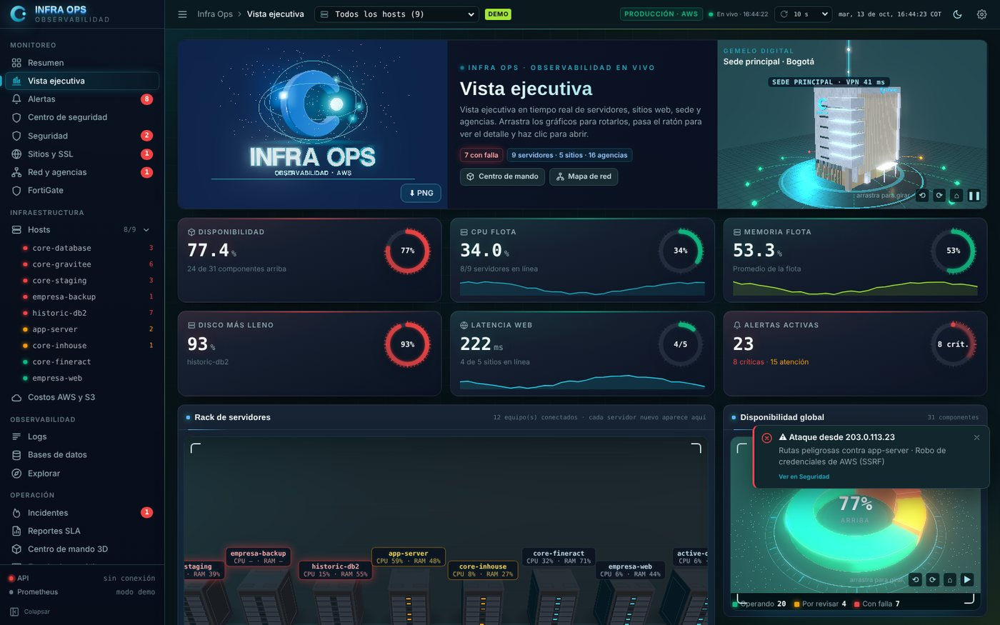
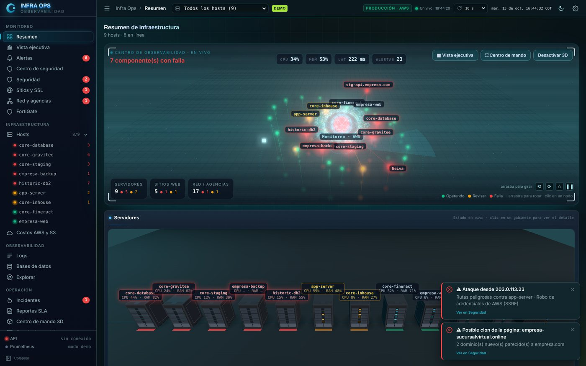
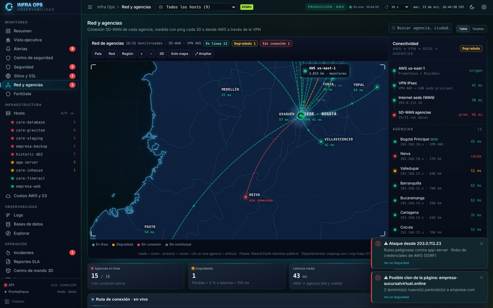
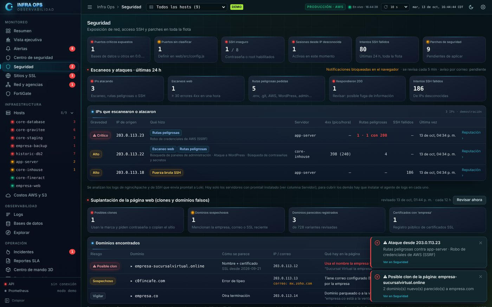
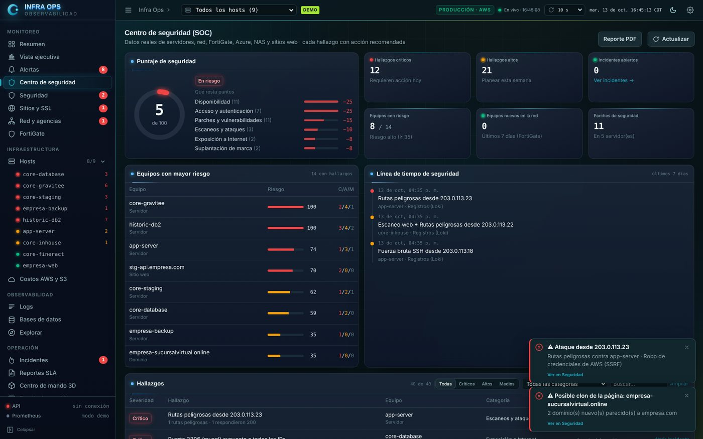
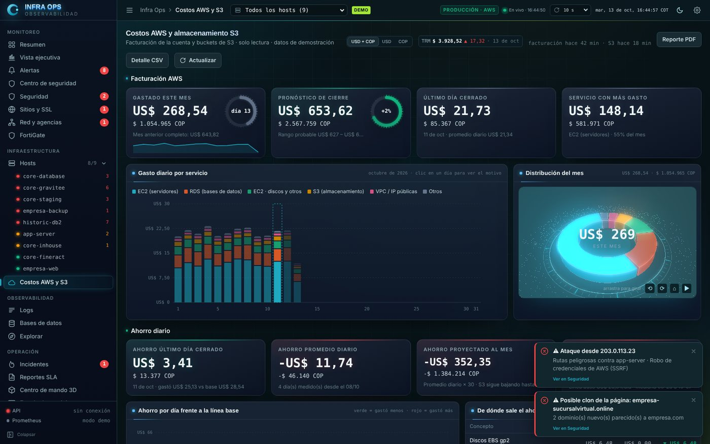
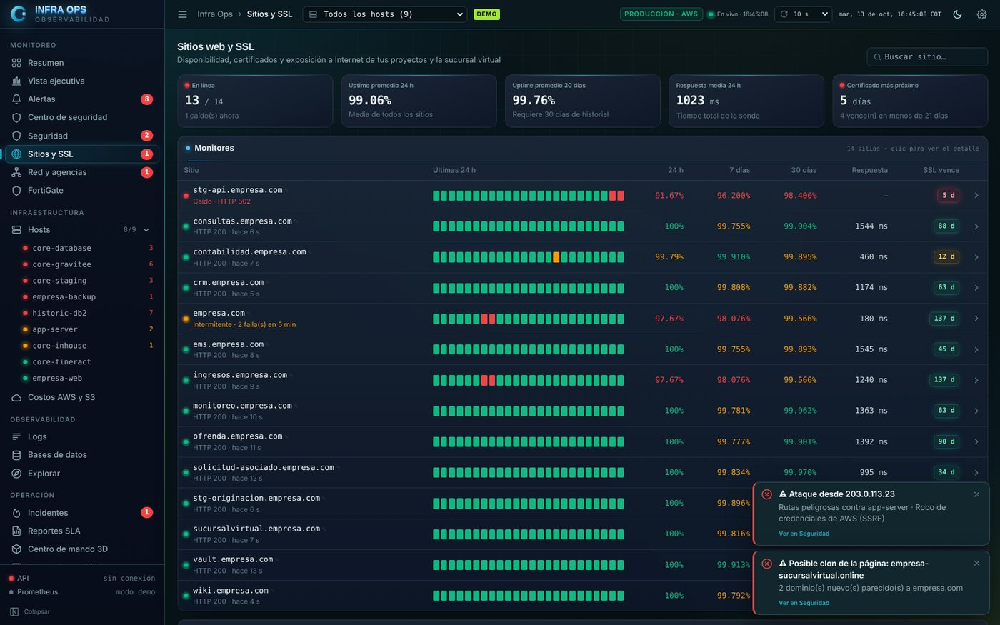
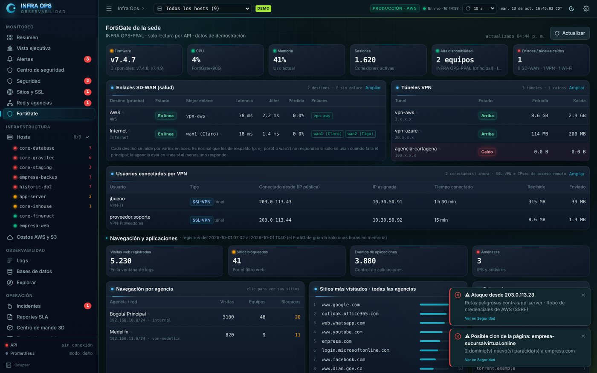
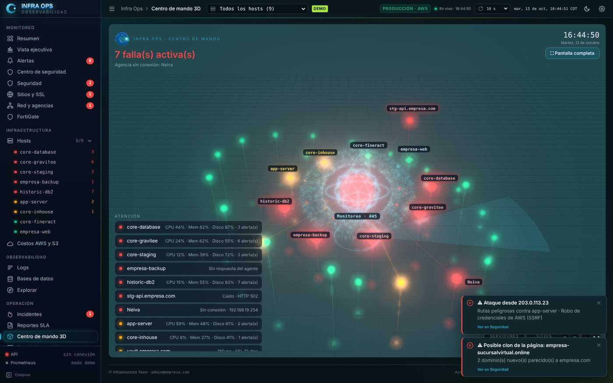
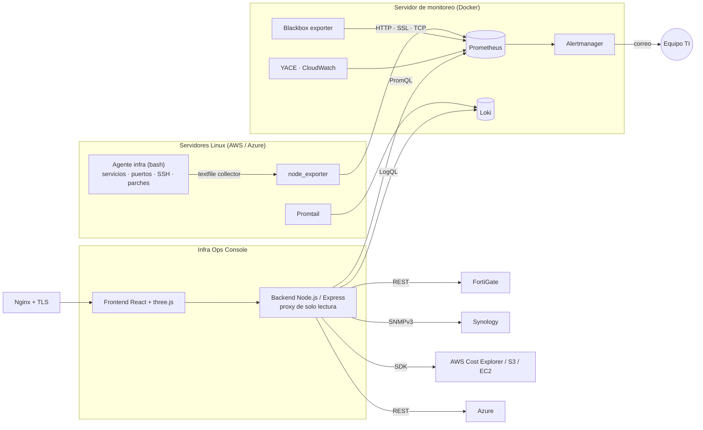

<div align="center">

# 🛰️ Infra Ops Console

**Centro de observabilidad para infraestructura híbrida: AWS, Azure, sede, agencias, firewall y NAS en un solo panel.**

[](https://github.com/juandbueno9/infra-ops-console/actions/workflows/ci.yml)
[](https://juandbueno9.github.io/infra-ops-console/)


### [▶ Ver demo en vivo](https://juandbueno9.github.io/infra-ops-console/)



</div>

> **Nota:** desarrollé este panel para la infraestructura real de una entidad financiera. Esta versión pública está **anonimizada**: los nombres, IPs (rangos de documentación RFC 5737), dominios y sedes son ficticios. La demo corre con datos simulados y no se conecta a ningún servidor.

---

## 📌 Tabla de contenido

- [Qué problema resuelve](#-qué-problema-resuelve)
- [Funcionalidades](#-funcionalidades)
- [Capturas](#-capturas)
- [Arquitectura](#-arquitectura)
- [Stack tecnológico](#-stack-tecnológico)
- [Inicio rápido](#-inicio-rápido)
- [Despliegue en producción](#-despliegue-en-producción)
- [Agente de métricas](#-agente-de-métricas)
- [Seguridad](#-seguridad)
- [API del backend](#-api-del-backend)
- [Estructura del proyecto](#-estructura-del-proyecto)
- [Roadmap](#-roadmap)

---

## 🎯 Qué problema resuelve

La infraestructura estaba repartida en **servidores Linux en AWS, máquinas en Azure, una sede principal con firewall FortiGate, 15 agencias conectadas por SD-WAN y varios NAS Synology**. Cada parte tenía su propia consola y los problemas se detectaban cuando un usuario llamaba.

**Infra Ops Console** junta todo en una sola vista en tiempo real:

| Antes | Después |
|---|---|
| 6 consolas distintas (AWS, Azure, FortiGate, Synology, Grafana, correo) | Un solo panel con navegación por área |
| Caídas detectadas por los usuarios | Alertas por correo antes del impacto |
| No se sabía quién entraba por SSH (todos usan `ubuntu`) | Identificación por **huella de llave SSH** y alerta de llaves desconocidas |
| Certificados SSL vencidos por sorpresa | Conteo de días y alerta a los 21 y 7 días |
| Factura de AWS revisada a fin de mes | Costo diario, pronóstico de cierre y presupuesto |
| Puertos expuestos sin control | Política de puertos por servidor y escaneo de exposición desde internet |

---

## ✨ Funcionalidades

<table>
<tr><td width="50%" valign="top">

### 📈 Monitoreo
- **Vista ejecutiva** con KPIs, gemelo digital 3D de la sede y rack 3D de servidores
- **Flota de hosts**: CPU, RAM, disco, red, servicios, puertos y contenedores
- **Alertas** con severidad, silencios y auditoría
- **Sitios y SSL**: uptime 24 h/7 d/30 d, latencia y vencimiento de certificados
- **Red y agencias**: mapa SD-WAN, latencia y pérdida por agencia, túneles VPN

</td><td width="50%" valign="top">

### 🔐 Seguridad
- **Centro de seguridad (SOC)** con puntaje y línea de tiempo de eventos
- Detección de **escaneos y ataques** (ping sweeps, SYN scans, rutas peligrosas)
- **Sesiones SSH** por persona, accesos fallidos y llaves desconocidas
- **Exposición de puertos** según el Security Group de cada servidor
- **Detección de dominios clon** (typosquatting y phishing) con certificados públicos (crt.sh)

</td></tr>
<tr><td valign="top">

### ☁️ Nube y costos
- **AWS**: facturación diaria (Cost Explorer), pronóstico, presupuesto y ahorro
- **S3**: inventario, tamaño, cifrado, versionado y acceso público
- **Azure**: máquinas virtuales y estado de los túneles VPN
- Conversión a pesos con la TRM oficial

</td><td valign="top">

### ⚙️ Operación
- **Incidentes** con responsable, línea de tiempo y causa raíz
- **Reportes SLA** exportables a PDF/CSV
- **Logs** centralizados (Loki) con búsqueda
- **FortiGate**: SD-WAN, VPN, usuarios conectados y navegación
- **NAS Synology** por SNMPv3 (volúmenes, discos y temperatura)
- **Notificaciones** por correo configurables por destinatario

</td></tr>
</table>

---

## 🖼️ Capturas

| Resumen de la flota | Red y agencias (SD-WAN) |
|---|---|
|  |  |
| **Seguridad: ataques, SSH y dominios clon** | **Centro de seguridad (SOC)** |
|  |  |
| **Costos de AWS y S3** | **Sitios web y SSL** |
|  |  |
| **Firewall FortiGate** | **Centro de mando 3D** |
|  |  |

---

## 🏗️ Arquitectura



**Decisiones de diseño**

- **El backend es un proxy de solo lectura.** El navegador nunca habla directo con Prometheus, Loki ni las APIs de nube, y las credenciales viven solo en el servidor.
- **Prometheus no se expone a internet.** En desarrollo se accede por **túnel SSH** (`npm run tunnel`).
- **Instalación sin tocar lo existente.** El stack nuevo va en un `docker-compose` aparte, con respaldo, validación (`promtool`) y **reversión automática** si algo falla.
- **Estado compartido simple.** Silencios, hosts ocultos y auditoría se guardan en JSON/JSONL de solo agregar, sin base de datos extra.
- **Modo demo integrado** (`?demo` o `--mode demo`) con datos realistas, para diseñar sin conexión y para esta demo pública.

---

## 🧰 Stack tecnológico

| Capa | Tecnologías |
|---|---|
| **Frontend** | React 18 · Vite 5 · Tailwind CSS 3 · three.js (escenas 3D) · SVG |
| **Backend** | Node.js 20 · Express · AWS SDK v3 · net-snmp |
| **Métricas** | Prometheus · node_exporter · Blackbox exporter · YACE (CloudWatch) |
| **Logs** | Loki · Promtail |
| **Alertas** | Alertmanager · reglas PromQL (33 reglas) · reglas LogQL |
| **Infraestructura** | Ubuntu Server · Docker Compose · Nginx · systemd · iptables · fail2ban |
| **Integraciones** | AWS (EC2, S3, Cost Explorer, CloudWatch) · Azure · FortiGate API · Synology SNMPv3 · crt.sh |
| **CI/CD** | GitHub Actions (build, ShellCheck, promtool) · GitHub Pages (demo) |

---

## 🚀 Inicio rápido

### Opción 1: ver la demo sin instalar nada

👉 **https://juandbueno9.github.io/infra-ops-console/**

### Opción 2: demo local

```bash
git clone https://github.com/juandbueno9/infra-ops-console.git
cd infra-ops-console/web
npm install
npm run dev:demo          # http://localhost:5173
```

### Opción 3: con datos reales

**Requisitos:** Node.js 20+, acceso SSH al servidor de Prometheus.

```bash
npm run install:all
cp server/.env.example server/.env   # configura Prometheus, Loki y (opcional) AWS, Azure, FortiGate, Synology

# Terminal 1: túnel SSH seguro a Prometheus y Loki (solo escucha en 127.0.0.1)
npm run tunnel

# Terminal 2: backend (:4000) + frontend (:5173)
npm run dev
```

**Atajos de teclado:** `R` actualiza los datos · `[` colapsa el menú.

---

## 🖥️ Despliegue en producción

```bash
# 1. Stack de observabilidad (Loki, Promtail, Alertmanager, reglas, retención 90 días)
sudo bash deploy/stack/instalar-stack.sh
sudo bash deploy/stack/crear-usuarios-bd.sh                 # usuarios de solo lectura MySQL/PostgreSQL
sudo bash deploy/stack/instalar-stack.sh --bd-mysql --bd-postgres

# 2. Panel: release versionado + servicio systemd con usuario sin privilegios
npm run build
sudo bash deploy/panel/servidor-instalar.sh

# 3. Nginx como reverse proxy con TLS
#    ver deploy/nginx-estado.conf
```

| Script | Qué hace |
|---|---|
| `deploy/stack/instalar-stack.sh` | Instala Loki, Promtail, Alertmanager y las reglas. Hace respaldo y revierte solo si la validación falla |
| `deploy/stack/desinstalar-stack.sh` | Deja el servidor exactamente como estaba |
| `deploy/aplicar-prometheus.sh` | Agrega jobs a `prometheus.yml` validando con `promtool` antes de recargar |
| `deploy/blackbox-hosts.sh` | Registra sitios web y certificados a monitorear |
| `deploy/escaneos-red.sh` | Reglas `iptables` que **registran** ping sweeps y SYN scans (sin bloquear) |
| `deploy/fail2ban-metricas.sh` | Expone baneos de fail2ban como métricas |
| `deploy/diagnostico-vpn.sh` | Diagnóstico de los túneles VPN |
| `deploy/panel/servidor-instalar.sh` | Instala el panel como servicio `systemd` con usuario de sistema dedicado |
| `docs/revertir-servidor.md` | Procedimiento de reversión completo |

---

## 🛰️ Agente de métricas

`agent/infra-agent-install.sh` se instala en cada servidor e instala o configura **node_exporter** con métricas propias (`infra_*`) por textfile collector:

- **Servicios** systemd activos y caídos
- **Puertos** en escucha con el proceso que los usa (para la política de exposición)
- **Contenedores** Docker
- **Sesiones SSH** activas, accesos y fallidos, con **identificación por huella de llave**
- **Parches** de seguridad pendientes
- **Metadatos de AWS** (tipo de instancia, zona) por IMDSv2

```bash
curl -fsSL https://…/infra-agent-install.sh | sudo bash
```

Para mostrar nombres en lugar de huellas, crea `/etc/infra-ssh-keys`:

```text
SHA256:AbCdEf0123...  Ana Admin
SHA256:ZyXwVu9876...  Carlos (Operaciones)
```

Si alguien entra con una llave no registrada, aparece como **"Llave desconocida"** y se genera una alerta.

---

## 🔐 Seguridad

- **Mínimo privilegio:** IAM de AWS solo lectura ([`deploy/aws/iam-facturacion.json`](deploy/aws/iam-facturacion.json), [`deploy/stack/iam-monitoreo.json`](deploy/stack/iam-monitoreo.json)), rol *Lector* en Azure, SNMPv3 con autenticación y cifrado, usuarios de base de datos de solo lectura.
- **Secretos fuera del código:** todo por `.env`, con plantillas `.env.example`.
- **Sin exposición:** backend en `127.0.0.1`, Nginx con TLS al frente, Prometheus solo por túnel.
- **Auditoría:** cada acción del panel (silenciar, ocultar, exportar) y cada ingreso queda en `audit-AAAA-MM.jsonl`, que es de solo agregar.
- **Inicio de sesión con Keycloak** (OpenID Connect, *authorization code* + PKCE) y roles: `ROLE_MONITOREO_ADMIN` puede modificar; `ROLE_MONITOREO_USER` solo consulta (cualquier escritura responde `403`).
- **Cierre de sesión por inactividad**, controlado también en el servidor, y confirmación explícita para las acciones peligrosas.

---

## 🔌 API del backend

| Método | Ruta | Descripción |
|---|---|---|
| `GET` | `/api/health` | Estado del backend y de sus conexiones |
| `GET` | `/api/prom/:endpoint` | Proxy de solo lectura a Prometheus (`query`, `query_range`, `alerts`, `rules`) |
| `GET` | `/api/loki/query_range` | Proxy de solo lectura a Loki |
| `GET/POST` | `/api/incidents` | Gestión de incidentes |
| `POST` | `/api/hosts/:host/silence` · `/hide` | Silenciar u ocultar un host (queda auditado) |
| `GET` | `/api/audit` · `/api/audit.csv` | Consulta y exportación de la auditoría |
| `GET` | `/api/aws/billing` · `/api/aws/s3` | Facturación y almacenamiento de AWS |
| `GET` | `/api/fortigate/status` · `/traffic` | Estado del firewall y tráfico |
| `GET` | `/api/azure` · `/api/synology` | Inventario de Azure y NAS |
| `GET` | `/api/security` · `/api/netscan` · `/api/clones` | Eventos de seguridad, escaneos y dominios clon |

---

## 📁 Estructura del proyecto

```text
infra-ops-console/
├── agent/            # Agente bash para cada servidor (node_exporter + métricas infra_*)
├── deploy/
│   ├── stack/        # Loki, Promtail, Alertmanager, YACE, reglas (instalar / desinstalar)
│   ├── panel/        # Instalación del panel como servicio systemd
│   ├── aws/          # Políticas IAM de solo lectura
│   └── *.sh / *.yml  # Blackbox, exposición de puertos, escaneos, fail2ban, VPN
├── docs/             # Guías: agregar servidores, AWS, reversión, capturas
├── scripts/          # Túnel SSH, publicación de versiones
├── server/           # Backend Node.js / Express (proxy de solo lectura)
│   └── src/          # aws, azure, fortigate, synology, security, notify, audit…
├── web/              # Frontend React + Vite + Tailwind + three.js
│   └── src/
│       ├── pages/        # 20 vistas (Resumen, SOC, Red, Nube, Incidentes…)
│       ├── components/   # UI, gráficas, escenas 3D (rack, edificio, mapa)
│       ├── hooks/        # polling, rutas, acciones sobre hosts
│       └── lib/          # PromQL, análisis de alertas, datos demo
└── .github/workflows # CI (build, ShellCheck, promtool) y demo en GitHub Pages
```

---

## 🗺️ Roadmap

- [ ] Despliegue del stack con Ansible
- [ ] Alertas a Telegram o Teams además de correo
- [ ] Pruebas unitarias de las reglas de análisis (`lib/analyze.js`)
- [ ] Imagen Docker del panel

---

## 👤 Autor

**Juan Bueno**, Infraestructura TI · Observabilidad · Automatización

[](https://github.com/juandbueno9)
[](mailto:jdbueno009@gmail.com)

Licencia [MIT](LICENSE).
